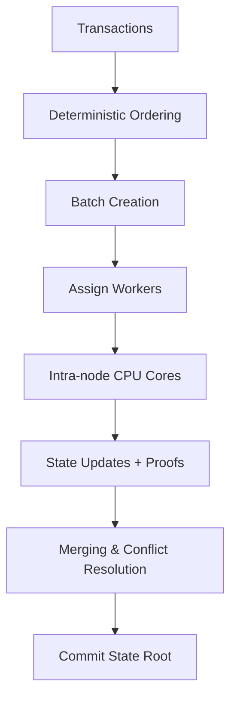
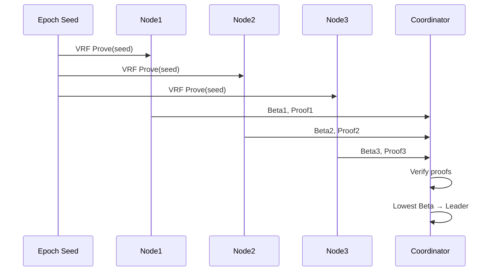

# DESYNC Protocol

DESYNC is a **next-generation execution-layer protocol** designed for **deterministic transaction ordering, parallelized batch execution, and verifiable state transitions**.  

Unlike traditional blockchain systems where ordering and execution are tightly coupled (causing bottlenecks), DESYNC **separates ordering from execution**, allowing multiple workers and CPU cores to process transactions in parallel while preserving a globally consistent state root.

---

## ✅ Current Progress (from TODO roadmap)

We started from a basic prototype and incrementally implemented key features:

- [x] **Modularized codebase**  
   - Core logic split into files (`types.go`, `statedb.go`, `merkle.go`, `execution.go`, etc.).  
   - Easier maintainability and testing.  

- [x] **Deterministic transaction ordering**  
   - Transactions sorted by `(BlockHeight, IndexInBlock, TxID)`.  
   - Ensures identical commit order across all nodes.  

- [x] **Deterministic merge ordering**  
   - All worker results merged by sorted keys before commit.  
   - Prevents nondeterminism from Go map iteration order.  

- [x] **Parallel batch execution with sync.Pool optimizations**  
   - Workers execute batches independently, results merged deterministically.  
   - Reduced allocation overhead via `sync.Pool`.  

- [x] **Intra-node parallel execution**  
   - Batches subdivided across CPU cores.  
   - Deterministic sorting ensures identical results across runs.  

- [x] **Merkle state root computation**  
   - Each block commits a deterministic Merkle root.  
   - Enables inclusion proofs and verifiable receipts.  

- [x] **Execution pipeline testing + benchmarking**  
   - Integrated Go benchmarks measuring TPS, allocations, memory usage.  
   - Deterministic test ensures all nodes/cores produce the same state root.  

- [x] **Scaling experiments**  
   - Achieved **~1.4M TPS** (1M transactions in <700ms) in local benchmarks.  

---

## 📊 Scaling Comparison

We benchmarked DESYNC under three scenarios:

- **Unconstrained** → Max parallel execution (all workers active).  
- **Constrained** → Simulated blockchain limits (restricted worker pool, memory pressure).  
- **Intra-node** → Worker batches subdivided across CPU cores.  

### Run benchmarks:

```bash
# Unconstrained
go test -bench=BenchmarkScalingUnconstrained -benchmem -run=^$ -v

# Constrained
go test -bench=BenchmarkScalingConstrained -benchmem -run=^$ -v

# Intra-node execution
go test -bench=BenchmarkScalingIntra -benchmem -run=^$ -v
````

### Generate comparison chart:

```bash
python3 plot_scaling_comparison.py
```

---

## 📈 Insights from Scaling

### Amdahl’s Law

The theoretical speedup of parallel execution is:

$$
S(N) = \frac{1}{(1-p) + \frac{p}{N}}
$$

* `p` = fraction of workload parallelizable
* `N` = number of cores
* `S(N)` = speedup vs single-core

| p (parallel fraction) | Cores | Speedup | TPS (base 10k) |
| --------------------- | ----- | ------- | -------------- |
| 0.5                   | 16    | 1.88    | 18,823         |
| 0.7                   | 16    | 2.90    | 29,090         |
| 0.9                   | 16    | 6.40    | 64,000         |

🔹 With **p=0.5 (50% parallel)** → diminishing returns after \~4 cores.
🔹 With **p=0.9 (90% parallel)** → scaling is nearly linear.

**Observation:** Intra-node execution achieves higher TPS than worker-only execution. Gains flatten beyond 20 workers/cores, where sequential bottlenecks (DB writes, state merges) dominate.

---

## ⚡ Features

* **Staged execution** → workers/core-local execution before committing.
* **Deterministic merge** → results combined in strict order, ensuring consensus safety.
* **Batched DB writes** → drastically reduces I/O overhead.
* **Sync pools** → pooled slices/maps minimize allocations.
* **Benchmark suite** → TPS, allocations, and throughput measured under different loads.
* **Proof system** → inclusion proofs from Merkle roots for verifiable state.

---

## Why DESYNC?

Current blockchains suffer from:

* **Throughput bottlenecks** → sequential execution dominates.
* **Fairness issues** → frontrunning & MEV distort ordering.
* **Poor scalability** → monolithic execution blocks parallelism.

DESYNC addresses these with:

* Deterministic ordering independent of execution.
* Batch-parallel execution across workers and CPU cores.
* Verifiable receipts & Merkle proofs for correctness.
* VRF-based leader election (low-bias).

---

## Benchmarks

Run with memory stats:

```bash
go test -bench=. -benchmem -run=^$ -v
```

Run **deterministic test**:

```bash
go test -v -run TestDeterministicExecution
```

Run **full execution pipeline test**:

```bash
go test -v -run TestFullExecutionPipeline -bench=. -benchmem
```

Example:

```
=== RUN   TestDeterministicExecution
    🎉 All configurations and runs produced the same final root: 2c3697500a11c903...
--- PASS: TestDeterministicExecution (2.1s)
```

---

## 🏗️ Architecture Overview

### Execution Flow



### Leader Election (VRF)



---

## 📂 Repository Structure

```
.
├── types.go                  # Core types (Transaction, Batch, Receipt, etc.)
├── statedb.go                # LevelDB-backed state database
├── merkle.go                 # Merkle tree + proofs
├── execution.go              # State machine + batch execution
├── workers.go                # Worker + intra-node execution
├── utils.go                  # Helpers (hashing, sorting, etc.)
├── main.go                   # Demo runner
├── desync_test.go            # Deterministic + scaling benchmarks
├── scaling_unconstrained.csv
├── scaling_constrained.csv
├── scaling_intra.csv
├── plot_scaling_comparison.py # Benchmark visualization
├── README.md                 # This file
└── PROGRESS.md               # Running implementation log
```

---

## Example Run

```bash
DESYNC prototype (intra-node update). Demo run...
Created 3 batches
Batch 1 → post_root 7e1b4c...
Batch 2 → post_root 9a3d12...
Batch 3 → post_root 6b42f8...
Final root after merged commit: 2c3697500a11c903...
```

```


