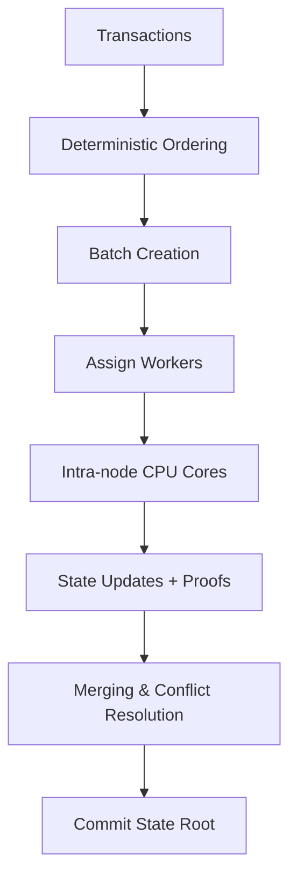
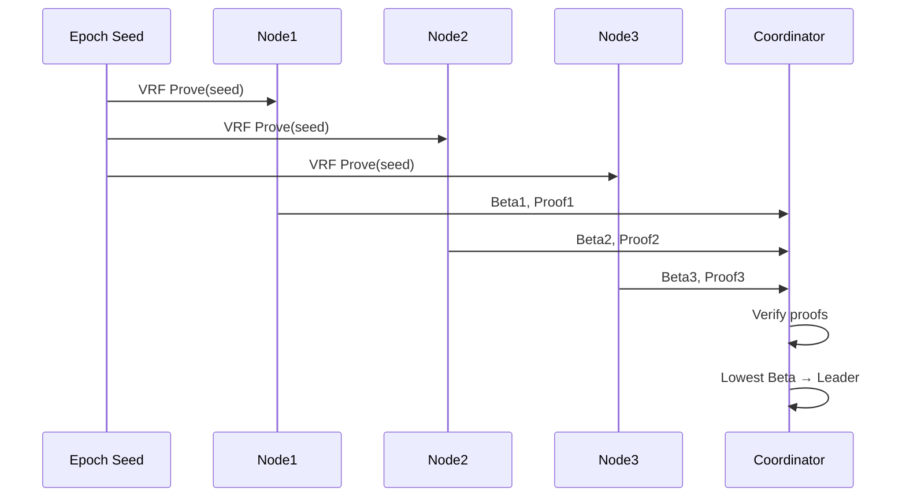

# DESYNC Protocol

DESYNC is a **next-generation execution-layer protocol** designed for **deterministic transaction ordering, parallelized batch execution, and verifiable state transitions**.  

Unlike traditional blockchain systems where ordering and execution are tightly coupled (causing bottlenecks), DESYNC **separates ordering from execution**, allowing multiple workers and CPU cores to process transactions in parallel while preserving a globally consistent state root.

---

## ✅ Current Progress (from TODO roadmap)

We started from a basic prototype and incrementally implemented key features:

- [x] **Deterministic transaction ordering**  
   - Transactions sorted by `(BlockHeight, IndexInBlock, TxID)`.  
   - Preserves consistent output regardless of worker scheduling.  

- [x] **Parallel batch execution with sync.Pool optimizations**  
   - Workers execute batches independently, results merged deterministically.  
   - Reduced allocation overhead via `sync.Pool`.  

- [x] **Merkle state root computation**  
   - Each block commits a deterministic Merkle root.  
   - Enables inclusion proofs and verifiable receipts.  

- [x] **Execution pipeline testing + benchmarking**  
   - Integrated Go benchmarks measuring TPS, allocations, memory usage.  
   - Scaling tests simulate 20k → 200k → 2M transactions.  

- [x] **Scaling experiments**  
   - Achieved **~1.4M TPS** (1M transactions in <700ms) in local benchmarks.  

- [x] **Intra-node parallel execution**  
   - Beyond worker pools: batches are subdivided across CPU cores.  
   - Two strategies:  
     - Static partitioning → split evenly across cores.  
     - Work stealing → dynamic balancing between cores.  
   - Fully utilizes multicore CPUs, similar to PVM (Parallel Virtual Machine).  

---

## 📊 Scaling Comparison

We benchmarked DESYNC under three scenarios:

- **Unconstrained** → Max parallel execution (all workers active).  
- **Constrained** → Simulated blockchain limits (restricted worker pool, memory pressure).  
- **Intra-node** → Worker batches subdivided across CPU cores.  

### Run benchmarks:

```bash
# Unconstrained
go test -bench=BenchmarkScalingUnconstrained -benchmem -run=^$ -v

# Constrained
go test -bench=BenchmarkScalingConstrained -benchmem -run=^$ -v

# Intra-node execution
go test -bench=BenchmarkScalingIntra -benchmem -run=^$ -v
````

### Generate comparison chart:

```bash
python3 plot_scaling_comparison.py
```

---

## 📈 Insights from Scaling

### Amdahl’s Law

The theoretical speedup of parallel execution is:

$$
S(N) = \frac{1}{(1-p) + \frac{p}{N}}
$$

* `p` = fraction of workload parallelizable
* `N` = number of cores
* `S(N)` = speedup vs single-core

| p (parallel fraction) | Cores | Speedup | TPS (base 10k) |
| --------------------- | ----- | ------- | -------------- |
| 0.5                   | 1     | 1.0     | 10,000         |
| 0.5                   | 16    | 1.88    | 18,823         |
| 0.7                   | 16    | 2.90    | 29,090         |
| 0.9                   | 16    | 6.40    | 64,000         |

🔹 With **p=0.5 (50% parallel)** → diminishing returns after \~4 cores.
🔹 With **p=0.9 (90% parallel)** → scaling is almost linear up to many cores.

**Observation:** Intra-node execution shows slightly higher TPS than worker-only execution. Gains flatten beyond 5–20 workers/cores, where sequential bottlenecks (DB writes, state merges) dominate.

---

## ⚡ Features

* **Staged execution** → workers/core-local execution before committing.
* **Deterministic merge** → results combined in strict order, ensuring consensus safety.
* **Batched DB writes** → drastically reduces I/O overhead.
* **Sync pools** → pooled slices/maps minimize allocations.
* **Benchmark suite** → TPS, allocations, and throughput measured under different loads.

---

## Why DESYNC?

Current blockchains suffer from:

* **Throughput bottlenecks** → sequential execution dominates.
* **Fairness issues** → frontrunning & MEV distort ordering.
* **Poor scalability** → monolithic execution blocks parallelism.

DESYNC addresses these with:

* Deterministic ordering independent of execution.
* Batch-parallel execution across workers and CPU cores.
* Verifiable receipts & Merkle proofs for correctness.
* VRF-based leader election (low-bias).

---

## Benchmarks

Run with memory stats:

```bash
go test -bench=. -benchmem -run=^$ -v
```

Run **full execution pipeline test**:

```bash
go test -v -run TestFullExecutionPipeline -bench=. -benchmem
```

Example:

```
=== RUN   TestFullExecutionPipeline
    ✅ 1,000,000 tx → 10 batches (100 workers, batchSize=10000)
    Elapsed: 686.9ms
    Throughput: 1,455,731 tx/s
    Final state root: 34dc92c917c2...
--- PASS: TestFullExecutionPipeline (1.02s)
BenchmarkExecutionPipeline
BenchmarkExecutionPipeline-4   	       2	 680161478 ns/op	353 MB/op	2.1M allocs/op
```

---

## 🏗️ Architecture Overview

### Execution Flow



### Leader Election (VRF)




## 📂 Repository Structure

```
.
├── desync.go                  # Core protocol implementation
├── desync_test.go             # Benchmarks (workers + intra-node execution)
├── scaling_unconstrained.csv
├── scaling_constrained.csv
├── scaling_intra.csv
├── plot_scaling_comparison.py # Benchmark visualization
└── README.md                  # This file
```

---

## Example Run

```bash
DESYNC prototype (intra-node update). Demo run...
Created 3 batches
Batch 1 → post_root 7e1b4c...
Receipt verified
Batch 2 → post_root 9a3d12...
Receipt verified
Batch 3 → post_root 6b42f8...
Receipt verified
```

