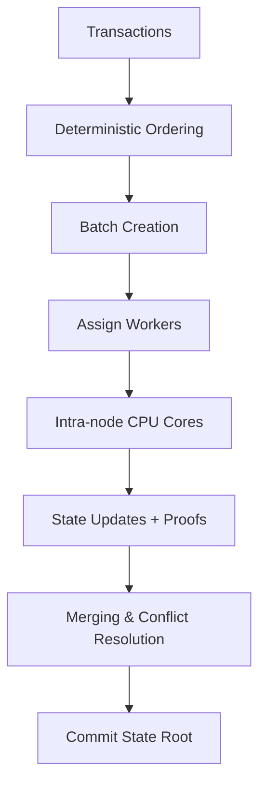
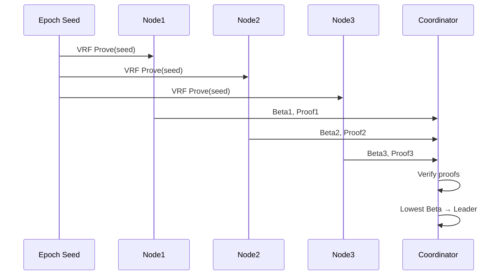

# DESYNC Protocol

DESYNC is a **next-generation execution-layer protocol** designed for **deterministic transaction ordering, parallelized batch execution, and verifiable state transitions**.  

Unlike traditional blockchain systems where ordering and execution are tightly coupled (causing bottlenecks), DESYNC **separates ordering from execution**, allowing multiple workers and CPU cores to process transactions in parallel while preserving a globally consistent state root.

---

## ✅ Current Progress
👉 See [PROGRESS.md](PROGRESS.md).


---

## 📊 Scaling Comparison
Worker batches are subdivided across CPU cores. 
We benchmarked DESYNC under two scenarios:

- **Unconstrained** → Max parallel execution (all workers active). 
- **Constrained** → Simulated blockchain limits (restricted worker pool, memory pressure). 
Constrained vs Unconstrained Execution

Unconstrained

All workers run in parallel.

Batches are executed concurrently and merged into a single commit per block.

Represents an ideal, high-performance environment.

Constrained

Worker count fluctuates per block to simulate real-world resource degradation and recovery (e.g., 10 → 5 → 2 → 5 → 7).

Batches are executed sequentially, with an immediate commit per batch.

Represents environments with limited or unstable resources (disk IO bottlenecks, CPU throttling, etc.).

👉 This way, constrained execution isn’t just “slower” — it actually models degraded conditions, which is more realistic for production-like stress testing.

[scaling_comparison_uc.png](scaling_comparison_uc.png)


---

## 📈 Insights from Scaling

### Amdahl’s Law

The theoretical speedup of parallel execution is:

$$
S(N) = \frac{1}{(1-p) + \frac{p}{N}}
$$

* `p` = fraction of workload parallelizable
* `N` = number of cores
* `S(N)` = speedup vs single-core

| p (parallel fraction) | Cores | Speedup | TPS (base 10k) |
| --------------------- | ----- | ------- | -------------- |
| 0.5                   | 16    | 1.88    | 18,823         |
| 0.7                   | 16    | 2.90    | 29,090         |
| 0.9                   | 16    | 6.40    | 64,000         |

🔹 With **p=0.5 (50% parallel)** → diminishing returns after \~4 cores.
🔹 With **p=0.9 (90% parallel)** → scaling is nearly linear.

**Observation:** Intra-node execution achieves higher TPS than worker-only execution. Gains flatten beyond 20 workers/cores, where sequential bottlenecks (DB writes, state merges) dominate.

---

## ⚡ Features

* **Staged execution** → workers/core-local execution before committing.
* **Deterministic merge** → results combined in strict order, ensuring consensus safety.
* **Batched DB writes** → drastically reduces I/O overhead.
* **Sync pools** → pooled slices/maps minimize allocations.
* **Benchmark suite** → TPS, allocations, and throughput measured under different loads.
* **Proof system** → inclusion proofs from Merkle roots for verifiable state.

---

## Why DESYNC?

Current blockchains suffer from:

* **Throughput bottlenecks** → sequential execution dominates.
* **Fairness issues** → frontrunning & MEV distort ordering.
* **Poor scalability** → monolithic execution blocks parallelism.

DESYNC addresses these with:

* Deterministic ordering independent of execution.
* Batch-parallel execution across workers and CPU cores.
* Verifiable receipts & Merkle proofs for correctness.
* VRF-based leader election (low-bias).

## 🏗️ Architecture Overview

### Execution Flow



### Leader Election (VRF)



---

## 📂 Repository Structure

```
.
├── types.go                           # Core types (Transaction, Batch, Receipt, etc.)
├── statedb_smt.go                     # LevelDB-backed state database with SMT implementation
├── smt.go                             # Sparse Merkle Tree + proofs
├── execution.go                       # State machine + batch execution
├── workers.go                         # Worker + intra-node execution
├── utils.go                           # Helpers (hashing, sorting, etc.)
├── main.go                            # Demo runner
├── desync_test.go                     # Deterministic + scaling benchmarks
├── scaling_unconstrained.csv          # Benchmark data under "unconstrained" state
├── scaling_constrained.csv            # Benchmark data under constrained state
├── plot_scaling_comparison.py         # Benchmark visualization
├── README.md                          # Main documentation
├── MAKE_COMMANDS.md                   # Makefile workflow
└── PROGRESS.md                        # This file
```

---

## 🛠️ Makefile Commands

We use a `Makefile` to simplify running tests, benchmarks, and cleaning up.  

👉 See [MAKE_COMMANDS.md](MAKE_COMMANDS.md) for the full list of available commands.


